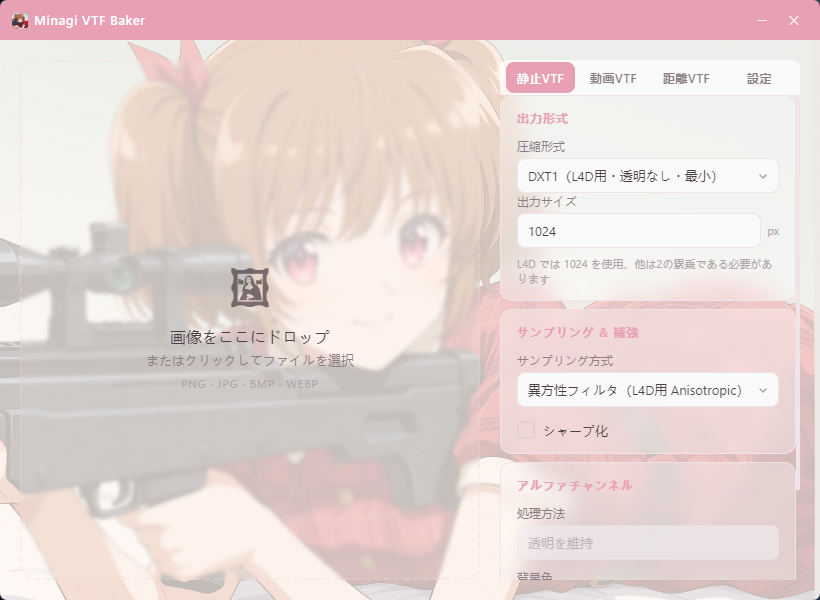
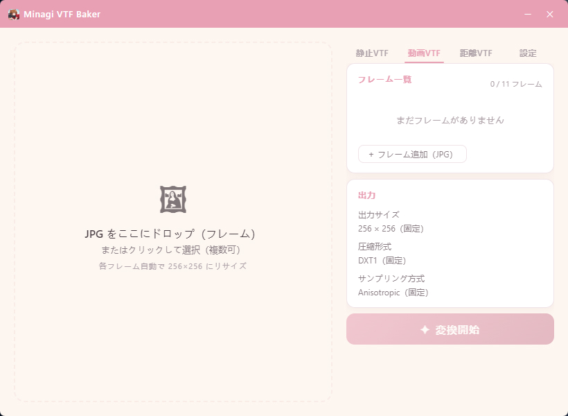
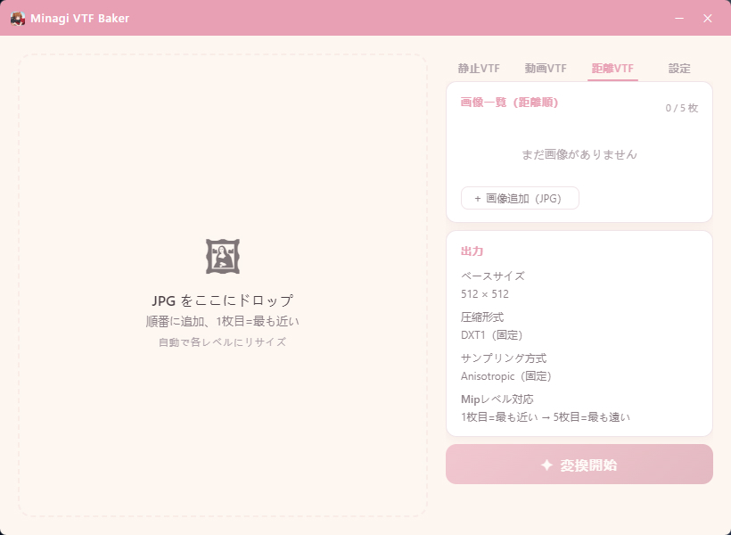
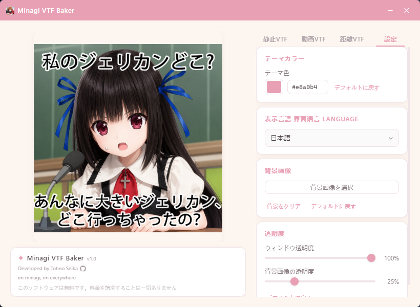

# Minagi VTF Baker ✦

> [English](README.md) · [中文](README.zh.md)

画像を **Left 4 Dead 2 のスプレー** に変換——簡単で、きれいで、速い。

PNG / JPG / BMP / WEBP 画像を **L4D2 互換の VTF スプレーファイル** に変換する Windows デスクトップツール。  
静止スプレー、動画スプレー、距離スプレーの 3 モードに対応。  
Tauri ベース——軽量でエレガント。

---

## ✨ 特徴

- 🖼️ **3 つのスプレーモード** — 静止 VTF / 動画スプレー / 距離スプレー
- 🎬 **ライブプレビュー** — 動画・距離スプレーの結果を左パネルにリアルタイム表示
- 🎨 **DXT 圧縮** — DXT1 / DXT5 / RGBA8888、アルファチャンネル対応
- 🔄 **サンプリング方式** — 異方性 / バイリニア / 最近傍
- ✏️ **シャープ化** — シャープネスフィルター（オプション）
- 🌐 **多言語 UI** — 简体中文 · 日本語 · English
- 🎨 **テーマカラー** — 好きな色に変更可能
- 🖼️ **カスタム背景** — 背景画像を設定可能
- 🪟 **ウィンドウ透明度** — UI と背景の透明度を個別に調整
- 🚀 **パフォーマンス** — インストーラ約 6MB、即時起動

---

## 📖 使い方

| 操作 | 説明 |
|:---|:---|
| 🖱️ **画像をドロップ** | 左パネルにドラッグ＆ドロップ、またはクリックしてファイル選択 |
| 🔧 **パラメータ設定** | 圧縮形式、出力サイズ、サンプリング方式などを選択 |
| ✨ **変換** | 「変換開始」をクリックし、保存ダイアログで保存先を選択（既定は元画像のフォルダー） |
| 🎬 **動画スプレー** | 「動画VTF」タブでフレーム画像を追加し、動画スプレーを生成 |
| 🌄 **距離スプレー** | 「距離VTF」タブで距離別にレイヤーを追加し、距離スプレーを生成 |
| ⚙️ **カスタマイズ** | 設定ページでテーマ色、背景画像、透明度を変更 |

> 🖱️ 追加したフレームとレイヤーはファイル名の自然順（`frame2` が `frame10` より前）で並びます。  
> 動画・距離スプレーは順序が結果に影響するので、リストの行をドラッグして並べ替えられます。  
> フレーム画像の対応形式は静止スプレーと同じ **PNG / JPG / BMP / WEBP** です（GIF 画像は受け付けません）。

---

## 🎮 VTF ファイルの使い方

### ⚠️ 注意事項
L4D2 で使用する静止スプレー VTF 生成の場合：
- **出力形式**は **DXT1** と **1024** を選択してください
- **サンプリング＆強調**は **Anisotropic** を選択してください
- **シャープ化**はオプションです。効果の見え方は画像によって変わります

### 📍 ファイルの保存先
「変換開始」をクリックすると保存ダイアログが開きます。既定の保存先は**元の画像があるフォルダ**で、既定のファイル名は次のとおりです：
- `static_minagi.vtf`（静止スプレー）
- `animated_minagi.vtf`（動画スプレー）
- `distance_minagi.vtf`（距離スプレー）

### 🎯 ゲーム内での使用方法
Left 4 Dead 2 を起動し、「オプション」→「マルチプレイヤー」→「カスタムスプレーのインポート」を開きます。VTF ファイルを選択し「完了」をクリックすると、次のマップから新しいスプレーが使用できます。

---

## 🎥 紹介動画

▶️ [Bilibili で見る](https://www.bilibili.com/video/BV1Hv7564ERA)（中国語のみ——UI・音声・字幕すべて中国語）

---

## 🖼 スクリーンショット

---

## 📦 ダウンロード

[Releases](https://github.com/TohnoSeika/minagi-vtf-baker/releases) ページから最新のインストーラをダウンロードしてください。

> 💡 現在のバージョン **v1.1.0**、インストーラ約 6MB。ポータブル版（インストール不要）もあります。

---

## 📋 更新履歴

### v1.1.0
- 🎬 動画タブの左側にアニメーションのライブプレビューを追加（プレビューはゲーム内の実際のアニメーションと完全には一致しない場合があります）
- 🌄 距離タブの左側に5段階のプレビューを追加。「最も近い」「最も遠い」のスライダーで各レベルを確認できます
- 📦 再インストール時に「先にアンインストールするか」を確認せず、自動で上書きするようになりました
- 🐛 静止タブで読み込んだ画像が動画・距離タブにも表示される問題を修正
- 💾 3種類のスプレー変換で「名前を付けて保存」ダイアログを表示（既定は元画像のフォルダー）
- 🎬 動画VTFと距離VTFの制作ページで、画像リストをドラッグして並べ替え可能
- 🎬 動画・距離スプレーのフレームが PNG / JPG / BMP / WEBP に対応、リストのサムネイルは小さなプレビューに
- 🐛 GIF 画像を読み込めてしまう BUG を修正
- 🖼️ EXIF の向きを適用し、スマホの縦撮り写真が横倒しにならないよう修正
- 🐛 大きな画像（3000×5000 など）をドロップした際に UI が長時間応答しなくなる問題を修正（デコードをバックグラウンドスレッドへ、プレビューは高速縮小に変更）
- 🐛 既定の背景画像が表示されない問題を修正
- 🐛 出力サイズとサンプリング方式の設定が効かない問題を修正
- 🐛 RGBA8888 が実際には DXT1 で出力される問題を修正
- 🔒 CSP を有効化し、デコードサイズ制限と安全なプレビュー描画を追加
- 🧹 未使用コードを整理し、ユニットテストを追加
- 🎉 v1.1.0 リリース

### v1.0.2
- 🐛 一部の場合でファイル選択ダイアログから画像を選択した際にパスが渡らず変換に失敗する問題を修正
- 🐛 一部の場合で初回の変換成功後に再度実行するとエラーになる問題を修正
- 🐛 一部の場合で「元のディレクトリに保存しました」と表示されるが実際には別の場所に保存される問題を修正
- 🐛 一部の場合でビルドスクリプトが古いインストーラを誤ってコピーする問題を修正
- 🐛 一部の場合でフロントエンドの変更がバイナリに正しく埋め込まれていなかった問題を修正
- 🐛 一部の場合で余分な括弧によるJS構文エラーでUIが完全に操作不能になる問題を修正
- 🐛 一部の場合でアニメーションスプレーで1フレームのみでもエラー表示されない問題を修正
- 🐛 一部の場合でアニメーション/距離スプレーの出力が元画像フォルダに保存されない問題を修正
- 🐛 一部の場合で距離スプレーで最大5枚の制限を超えて画像を追加できた問題を修正
- 🐛 一部の場合でドラッグ＆ドロップでフレーム数の上限を超えられた問題を修正
- 💄 アニメーション/距離スプレー画面のドロップゾーンはクリック無効化、右側のボタンから画像を追加
- 🌐 「クリックして選択」の文言を削除しヒントテキストを更新
- 🎉 v1.0.2 リリース

### v1.0.1
- 🎉 v1.0.1 リリース
- 🖼️ ソフトウェアUIの誤解を招く可能性があるテキスト表記を修正
- 🔧 出力形式ドロップダウンの選択肢を簡潔に修正（DXT1 / DXT5 / RGBA8888）

### v1.0
- 🎉 初版リリース
- 🖼️ 静止 / 動画 / 距離スプレー変換に対応
- 🌐 中日英対応 UI
- 🎨 テーマカラー、背景画像、透明度のカスタマイズ
- 🪟 ウィンドウ透明度制御

---

## 🤖 AI アシスタンス

本プロジェクトのコードおよび UI デザインの一部は AI 支援により作成されました。

---

## 📜 ライセンス

このソフトウェアは **フリーウェア** です。すべての権利は留保されています。  
詳細は [LICENSE](./LICENSE)（英語）· [LICENSE.zh](./LICENSE.zh)（中国語）· [LICENSE.ja](./LICENSE.ja)（日本語）を参照してください。

---

> このソフトウェアは無料です。料金を請求することは一切ありません。  
> Developed by Tohno Seika
