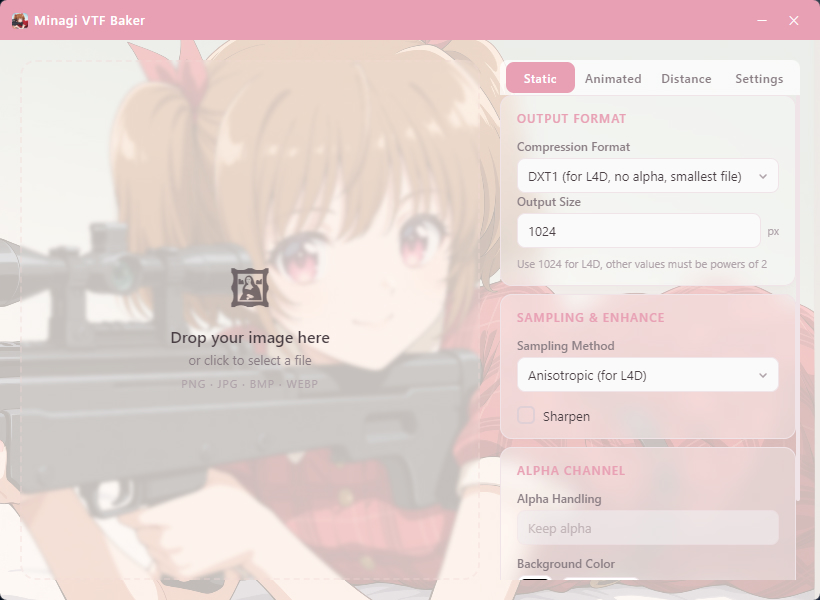
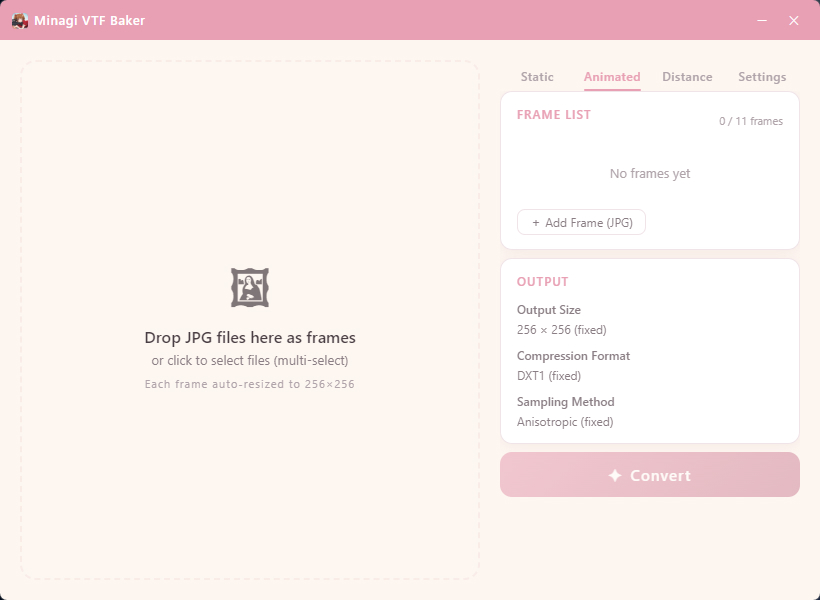
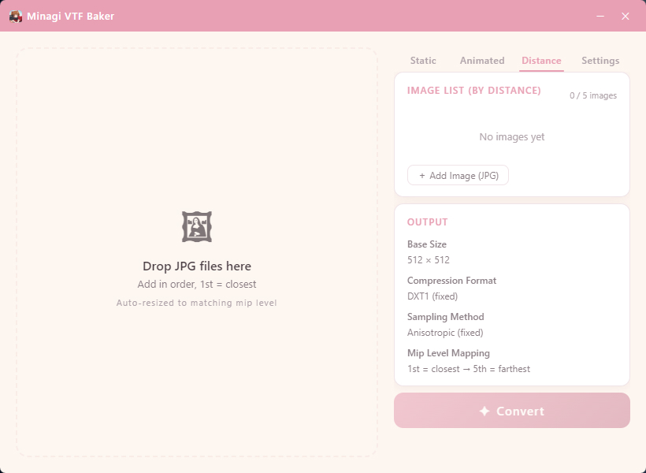
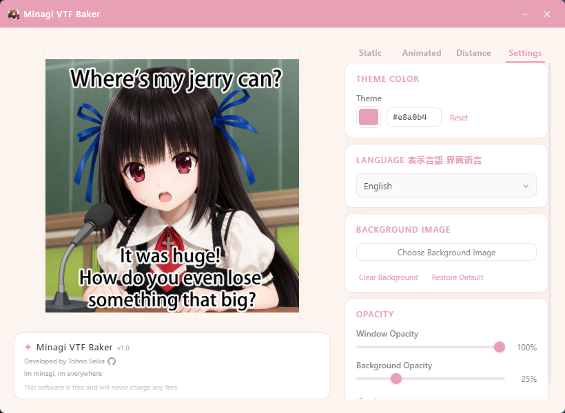

# Minagi VTF Baker ✦

> [中文](README.zh.md) · [日本語](README.ja.md)

Turn any image into a **Left 4 Dead 2 spray** — simple, beautiful, fast.

A Windows desktop tool that converts PNG / JPG / BMP / WEBP images into **L4D2-compatible VTF spray files**.  
Supports static, animated, and distance-blended sprays.  
Built with Tauri — lightweight and elegant.

---

## ✨ Features

- 🖼️ **Three Spray Modes** — Static VTF / Animated Spray / Distance-Blended Spray
- 🎬 **Live Preview** — Animated and distance sprays show a live preview of the result in the left panel
- 🎨 **DXT Compression** — DXT1 / DXT5 / RGBA8888 with alpha channel support
- 🔄 **Sampling Methods** — Anisotropic / Bilinear / Nearest Neighbor
- ✏️ **Sharpening** — Optional unsharp mask filter
- 🌐 **Multi-language UI** — 简体中文 · 日本語 · English
- 🎨 **Custom Theme** — Freely change the accent color
- 🖼️ **Custom Background** — Set your own background image
- 🪟 **Window Opacity** — Independent control for UI and background opacity
- 🚀 **Performance** — ~6MB installer, instant startup

---

## 📖 Usage

| Action | Description |
|:---|:---|
| 🖱️ **Drop an image** | Drag & drop onto the left panel, or click to select a file |
| 🔧 **Set parameters** | Choose compression format, output size, sampling method, etc. |
| ✨ **Convert** | Click "Convert", then choose where to save in the dialog (default: source folder) |
| 🎬 **Animated spray** | Switch to the "Animated" tab, add frame images, and build an animated spray |
| 🌄 **Distance spray** | Switch to the "Distance" tab, add layers by distance, and build a distance-blended spray |
| ⚙️ **Customize** | Go to Settings to change theme color, background image, and opacity |

> 🖱️ Frames and layers are sorted by file name when added (so `frame2` comes before `frame10`).  
> Drag any row in the list to adjust the order — both animated and distance sprays are order-sensitive.  
> Frames accept the same formats as static images: **PNG / JPG / BMP / WEBP**. GIF images are rejected.

---

## 🎮 How to Use the VTF File

### ⚠️ Important Notes
For L4D2 static spray VTF generation:
- **Output Format** must be set to **DXT1** and **1024**
- **Sampling** must be set to **Anisotropic**
- **Sharpening** is optional — how visible it is depends on the image

### 📍 File Location
Clicking "Convert" opens a save dialog. It defaults to the **source image's folder**, with these file names:
- `static_minagi.vtf` (Static spray)
- `animated_minagi.vtf` (Animated spray)
- `distance_minagi.vtf` (Distance spray)

### 🎯 In-Game Usage
Open Left 4 Dead 2, go to **Options** → **Multiplayer** → **Import custom spray**. Select your VTF file, click **Done**, and the new spray will appear starting from the next map.

---

## 🎥 Introduction Video

▶️ [Watch on Bilibili](https://www.bilibili.com/video/BV1Hv7564ERA) (The video is in Chinese — UI, audio, and subtitles)

---

## 🖼 Screenshots

---

## 📦 Download

Download the latest installer from the [Releases](https://github.com/TohnoSeika/minagi-vtf-baker/releases) page.

> 💡 Current version **v1.1.0**, ~6MB installer. A portable (no-install) version is also available.

---

## 📋 Changelog

### v1.1.0
- 🎬 Added a live animated preview on the Animated tab (the preview may not exactly match the in-game animation)
- 🌄 The Distance tab now previews all five mip levels on the left, with a labeled slider to step between closest and farthest
- 📦 Reinstalling now overwrites the previous version automatically, without asking whether to uninstall first
- 🐛 Fixed the image loaded on the Static tab also appearing on the Animated and Distance tabs
- 💾 Conversion now opens a Save As dialog for all three spray types (defaults to the source folder)
- 🎬 Image lists on the Animated VTF and Distance VTF pages support drag-to-reorder
- 🎬 Animated/distance frames now accept PNG / JPG / BMP / WEBP; list thumbnails are small previews
- 🐛 Fixed a bug where GIF images could be imported
- 🖼️ EXIF orientation is applied, so portrait phone photos are no longer sideways
- 🐛 Fixed the UI freezing for seconds when dropping large images (e.g. 3000×5000): decoding now runs off the main thread and previews use fast downscaling
- 🐛 Fixed the default background never appearing
- 🐛 Fixed the output size and sampling method settings being ignored
- 🐛 Fixed RGBA8888 output actually being encoded as DXT1
- 🔒 Added a Content Security Policy, image size limits, and safer preview rendering
- 🧹 Cleaned up dead code and added unit tests
- 🎉 v1.1.0 release

### v1.0.2
- 🐛 Fixed conversion failure caused by missing file path when selecting images via file picker in some cases
- 🐛 Fixed error on subsequent conversion attempts after a successful first run in some cases
- 🐛 Fixed toast claiming "saved to source directory" when the file was saved elsewhere in some cases
- 🐛 Fixed build script copying the wrong (old) installer to the dist folder in some cases
- 🐛 Fixed frontend code changes not being embedded into the final binary in some cases
- 🐛 Fixed UI being completely unresponsive due to an extra brace causing a JS syntax error in some cases
- 🐛 Fixed animated tab silently accepting a single frame without proper feedback in some cases
- 🐛 Fixed animated/distant spray output not being saved to the original image folder in some cases
- 🐛 Fixed distant spray allowing more than 5 images despite the limit in some cases
- 🐛 Fixed drag-and-drop bypassing the frame count limit in some cases
- 💄 Animated/distant drop zones are now click-disabled; use the side buttons to add images
- 🌐 Updated hint text across languages to remove "click to select" references
- 🎉 v1.0.2 release

### v1.0.1
- 🎉 v1.0.1 release
- 🖼️ Fixed potentially misleading text in the software UI
- 🔧 Cleaned up output format dropdown labels (DXT1 / DXT5 / RGBA8888)

### v1.0
- 🎉 Initial release
- 🖼️ Static / Animated / Distance spray conversion
- 🌐 Chinese / Japanese / English UI
- 🎨 Custom theme color, background image, and opacity
- 🪟 Window transparency control

---

## 🤖 AI Assistance

Part of this project's code and UI design was created with AI assistance.

---

## 📜 License

This software is **freeware**, all rights reserved.  
See [LICENSE](./LICENSE) (English) · [LICENSE.zh](./LICENSE.zh) · [LICENSE.ja](./LICENSE.ja) for details.

---

> This software is free and will never charge any fees.  
> Developed by Tohno Seika
