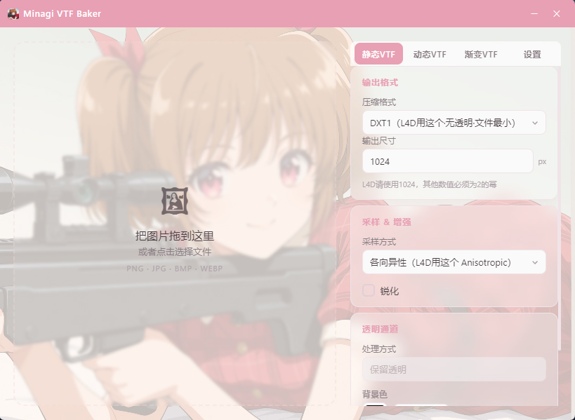
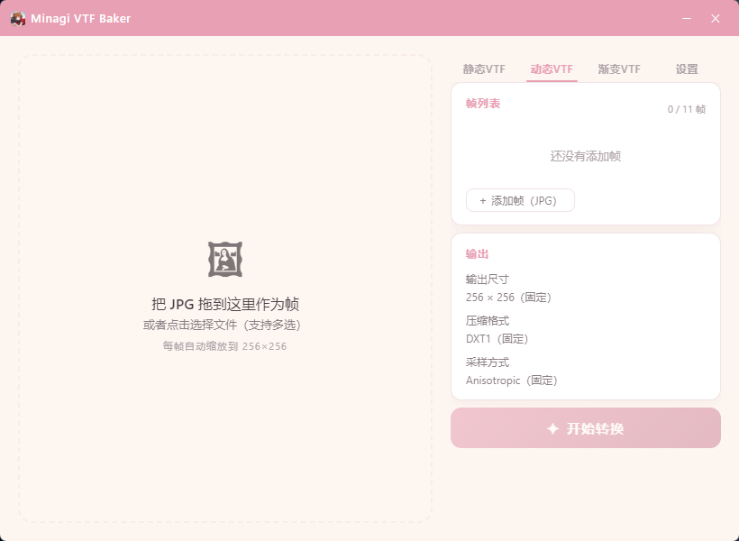
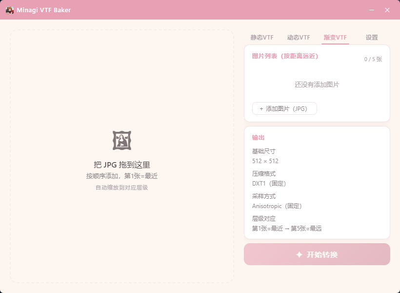
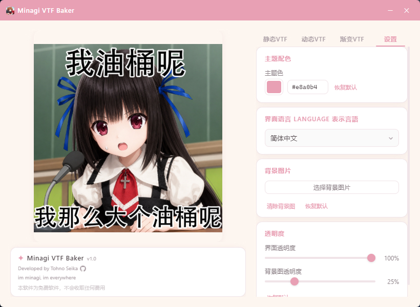

# Minagi VTF Baker ✦

> [English](README.md) · [日本語](README.ja.md)

把普通图片变成 **Left 4 Dead 2 的喷漆**——简单、漂亮、又快。

一个 Windows 桌面工具，将 PNG / JPG / BMP / WEBP 图片一键转换为 **L4D2 兼容的 VTF 喷漆文件**。  
支持静态喷漆、动态喷漆、远近渐变喷漆三种模式。  
基于 Tauri 构建，轻量、优雅。

---

## ✨ 特性

- 🖼️ **三种喷漆模式** —— 静态 VTF / 动态喷漆 / 远近渐变喷漆
- 🎬 **实时预览** —— 动态与渐变喷漆在左侧实时展示成品效果
- 🎨 **DXT 压缩** —— DXT1 / DXT5 / RGBA8888 可选，支持透明通道
- 🔄 **采样方式** —— 各向异性 / 双线性 / 最近邻
- ✏️ **锐化增强** —— 可选锐化滤镜
- 🌐 **多语言界面** —— 简体中文 / 日本語 / English
- 🎨 **主题配色** —— 自由更换主题色
- 🖼️ **自定义背景** —— 支持自定义背景图片
- 🪟 **自定义窗口透明度** —— 界面和背景图透明度独立调节
- 🚀 **性能** —— 安装包约 6MB，即时启动

---

## 📖 使用方法

| 操作 | 说明 |
|:---|:---|
| 🖱️ **拖入图片** | 把图片拖到左侧拖放区，或点击选择文件 |
| 🔧 **设置参数** | 选择压缩格式、输出尺寸、采样方式等 |
| ✨ **开始转换** | 点击「开始转换」，在保存对话框里选择位置（默认原图文件夹） |
| 🎬 **动态喷漆** | 切换到「动态VTF」，添加帧图片，合成动画喷漆 |
| 🌄 **渐变喷漆** | 切换到「渐变VTF」，按距离远近添加图层，生成远近喷漆 |
| ⚙️ **个性化** | 在设置页自定义主题色、背景图、透明度 |

> 🖱️ 添加的帧和图层会按文件名自然排序（`frame2` 排在 `frame10` 前面）。  
> 动态与渐变喷漆都对顺序敏感，直接拖动列表里的行就能调整顺序。  
> 帧图片支持的格式和静态喷漆一样：**PNG / JPG / BMP / WEBP**，GIF 图片会被拦截。

---

## 🎮 VTF 使用方法

### ⚠️ 注意事项
用于 L4D2 内使用的静态喷漆 VTF 生成：
- **输出格式**必须选择 **DXT1** 和 **1024**
- **采样&增强**必须选择 **Anisotropic**
- **锐化**是可选效果，明不明显取决于图片本身

### 📍 生成的文件在哪
点击「开始转换」会弹出保存对话框，默认位置是**原图片所在的文件夹**，默认文件名是：
- `static_minagi.vtf`（静态喷漆）
- `animated_minagi.vtf`（动态喷漆）
- `distance_minagi.vtf`（远近渐变喷漆）

### 🎯 如何在游戏内使用
打开 Left 4 Dead 2 游戏，进入「选项」，进入「多人联机」，选择「导入喷漆图案」，导入后点击「完成」即可在下一个关卡中使用新的喷漆。

---

## 🎥 介绍视频

▶️ [在 Bilibili 观看](https://www.bilibili.com/video/BV1Hv7564ERA)（完全中文——界面、语音、字幕均为中文）

---

## 🖼 截图

---

## 📦 下载

从 [Releases](https://github.com/TohnoSeika/minagi-vtf-baker/releases) 页面下载最新版本的安装包即可。

> 💡 当前版本 **v1.1.0**，安装包约 6MB。另有绿色便携版（无需安装，解压即用）。

---

## 📋 更新记录

### v1.1.0
- 🎬 动态喷漆左侧新增动画实时预览(动画预览不保证和游戏内实际动画效果完全相同)
- 🌄 渐变喷漆左侧新增五层预览，滑条在「最近」和「最远」之间切换查看每一级
- 📦 覆盖安装时不再询问是否先卸载旧版，直接自动覆盖
- 🐛 修复静态页拖入的图片也会显示在动态和渐变页面的问题
- 💾 三种喷漆的转换改为弹出「另存为」对话框，默认位置是原图文件夹
- 🎬 动态VTF和距离VTF制作页面的图片列表支持拖曳调整排序
- 🎬 动态/渐变喷漆的帧支持 PNG / JPG / BMP / WEBP，列表缩略图改为小尺寸预览
- 🐛 修复了可以导入 GIF 图片的 BUG
- 🖼️ 应用 EXIF 方向，手机竖拍的照片不再躺下
- 🐛 修复拖入大图片（如 3000×5000）时界面长时间无响应的问题：解码移到后台线程，预览改用快速缩放
- 🐛 修复默认背景图永远不显示的问题
- 🐛 修复输出尺寸和采样方式设置无效的问题
- 🐛 修复 RGBA8888 实际输出成 DXT1 的问题
- 🔒 启用内容安全策略、限制解码尺寸，预览渲染不再使用 innerHTML
- 🧹 清理无用代码并补充单元测试
- 🎉 v1.1.0 版本发布

### v1.0.2
- 🐛 修复在部分情况下通过点击选择图片时因路径缺失导致转换失败的问题
- 🐛 修复在部分情况下便携版中制作成功后再次制作会报错的问题
- 🐛 修复在部分情况下转换提示"已保存到原目录"但实际文件并未出现在原目录的问题
- 🐛 修复在部分情况下构建脚本错误复制旧版安装包的问题
- 🐛 修复在部分情况下前端代码修改未被正确打包进二进制的问题
- 🐛 修复在部分情况下因多余大括号导致界面完全无法操作的问题
- 🐛 修复在部分情况下动态喷漆单张图片时无提示的问题
- 🐛 修复在部分情况下动态/渐变喷漆输出文件未保存在原图文件夹的问题
- 🐛 修复在部分情况下渐变喷漆可添加超过 5 张图片上限的问题
- 🐛 修复在部分情况下拖入文件可突破帧数限制的问题
- 💄 动态/渐变喷漆页面拖拽区仅接受拖入，选择图片需通过右侧按钮
- 🌐 更新多语言提示文字，去除"点击选择文件"相关描述
- 🎉 v1.0.2 版本发布

### v1.0.1
- 🎉 v1.0.1 版本发布
- 🖼️ 修复软件界面文本显示可能存在的误导性
- 🔧 精简了输出格式下拉菜单的选项文字（DXT1 / DXT5 / RGBA8888）

### v1.0
- 🎉 初版发布
- 🖼️ 支持静态 / 动态 / 远近渐变三种喷漆转换
- 🌐 中/日/英三语界面
- 🎨 主题色、背景图、透明度自定义
- 🪟 窗口透明度控制

---

## 🤖 AI 辅助声明

本项目的部分代码及界面设计借助 AI 辅助完成。

---

## 📜 许可证

本项目为 **免费软件**，保留所有权利。  
详情请参见 [LICENSE](./LICENSE)（英文）· [LICENSE.zh](./LICENSE.zh)（中文）· [LICENSE.ja](./LICENSE.ja)（日文）文件。

---

> 本软件为免费软件，不会收取任何费用。  
> Developed by Tohno Seika
